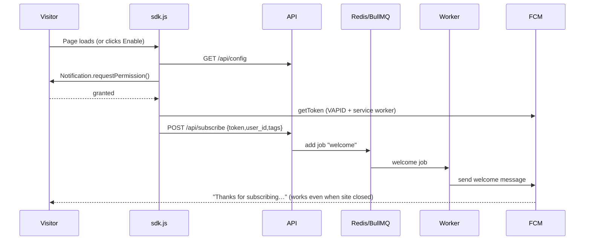
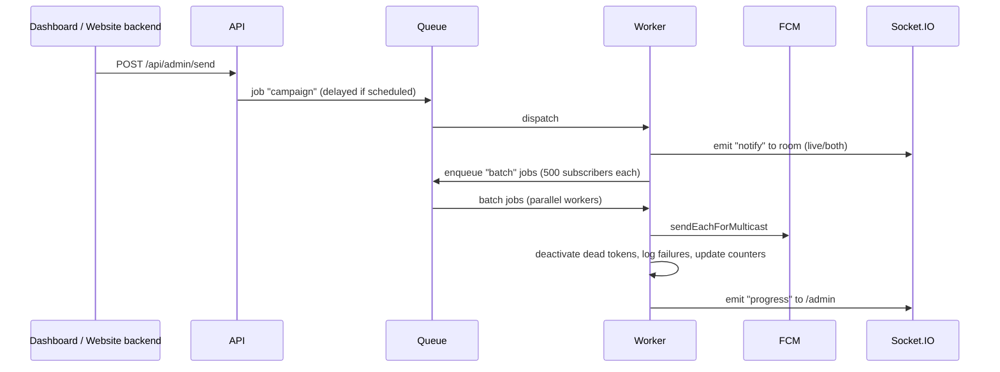

# Workflows

## 1. Subscribe + welcome notification

## 2. Send campaign (push / live / both)

## 3. Click tracking
Service worker `notificationclick` → `POST /api/click` → opens `url`. Live toasts do the same on click.

## 4. Adding to your website (checklist)
1. Deploy server + worker, HTTPS on, WebSocket proxy enabled.
2. Dashboard → Code Builder → configure.
3. Upload generated `firebase-messaging-sw.js` to site root.
4. Paste `<script>` embed tag before `</body>`.
5. Visit the site, allow notifications, confirm the welcome push arrives.
6. Add the PHP/curl trigger to backend events (order placed, payment success, etc.).

## 5. Troubleshooting
| Symptom | Check |
|---|---|
| No permission prompt | HTTPS? Already blocked in browser site settings? `data-auto="false"`? |
| Token error | SW file reachable at `/firebase-messaging-sw.js` on the same origin; VAPID key matches Firebase project |
| Welcome not received | Worker running? Redis reachable? Check worker logs |
| Live toast missing | `/socket.io/` proxied with upgrade headers; `SITE_KEY` correct |
| High failures | Expired tokens are normal; they are auto-deactivated |
